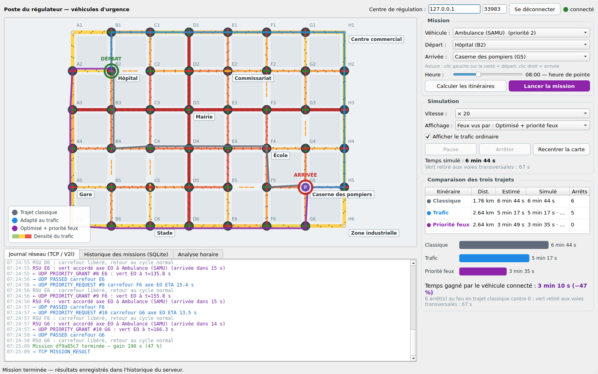

# SAÉ 3.02 : optimisation du trajet des véhicules prioritaires

Maquette de l'équipe **Les Nouveaux** (Youssef Jabrane, David Duraes Valadares), BUT R&T 2e année.

Une ambulance, un camion de pompiers ou une voiture de police perd du temps à cause du
trafic et des feux rouges. L'application simule une ville et compare trois façons d'aller
d'un point A à un point B :

| Stratégie | Principe |
|---|---|
| **Trajet classique** | Le plus court en distance, comme un GPS naïf. Le véhicule subit le trafic et les feux. |
| **Adapté au trafic** | Le plus rapide compte tenu de la densité du trafic **à l'heure choisie** et des plans de feux connus du centre de régulation. |
| **Optimisé + priorité feux** | Le véhicule est connecté : à l'approche de chaque carrefour, il demande le vert en V2I (UDP). Le carrefour connecté (RSU) libère le passage, puis revient au cycle normal. |

Les trois véhicules roulent **en même temps**, chacun dans son propre « monde » (même trafic,
mêmes feux au départ), ce qui donne une comparaison équitable. À 8 h, sur le trajet
Hôpital (B2) → Caserne des pompiers (G5), on obtient par exemple :

| | Temps | Arrêts aux feux |
|---|---|---|
| Classique | 6 min 44 s | 6 |
| Adapté au trafic | 5 min 17 s (−22 %) | 5 |
| Priorité feux | 3 min 35 s (−47 %) | 0 |

Sur 500 missions tirées au hasard (départ, arrivée et heure aléatoires), le trajet avec
priorité aux feux fait gagner **35 % en moyenne** par rapport au trajet classique, et le
trajet adapté au trafic 13 %.



## Architecture

```
 ┌──────────────── Poste du régulateur (client PyQt6) ───────────────┐
 │  IHM : QGraphicsView (carte), tableaux, graphiques                 │
 │    ▲ signaux / slots Qt uniquement                                 │
 │  QThread ClientTcp      QThread LienV2I (OBU)   QThread Mission    │
 └──────┬─────────────────────────┬───────────────────────────────────┘
        │ TCP 5050                │ UDP 5051
        │ trames JSON + '\n'      │ datagrammes JSON (V2I)
 ┌──────▼─────────────────────────▼───────────────────────────────────┐
 │ Centre de régulation (serveur) : une boucle `select`               │
 │  - modèle de la ville, densités par heure, calcul des itinéraires  │
 │  - carrefours connectés (RSU) : accord / refus / révocation du vert│
 │  - historique des missions dans SQLite                             │
 └────────────────────────────────────────────────────────────────────┘
```

* Le **serveur** (`lancer_serveur.py`) détient la ville et calcule les itinéraires. Il joue
  aussi le rôle des carrefours connectés (RSU). Une seule boucle `select` multiplexe la socket
  d'écoute TCP, les clients connectés et la socket UDP.
* Le **client** (`lancer_client.py`) est le poste du régulateur. Il affiche la carte et anime
  la mission. Il embarque aussi l'unité du véhicule connecté (OBU), qui envoie les messages V2I.
* Le réseau, la simulation et l'analyse tournent chacun dans un `QThread`. Aucun thread ne
  touche à l'IHM : tout passe par des `pyqtSignal`.
* Le client et le serveur peuvent tourner sur la même machine (par défaut) ou sur deux PC.

## Installation (Windows)

```bat
python -m venv .venv
.venv\Scripts\activate
pip install -r requirements.txt
```

Sous Linux ou macOS : `python3 -m venv .venv && source .venv/bin/activate && pip install -r requirements.txt`.

Seul PyQt6 est à installer. Tout le reste vient de la bibliothèque standard (`socket`,
`select`, `json`, `threading`, `sqlite3`, `math`, `random`, `time`, `datetime`).

## Lancement

Dans deux terminaux, depuis le dossier du projet :

```bat
python lancer_serveur.py
python lancer_client.py
```

Sur deux machines : `python lancer_client.py --hote 192.168.1.20` (IP du serveur). Les ports
TCP 5050 et UDP 5051 doivent être ouverts dans le pare-feu du serveur.

Options du serveur : `--port 5050 --udp 5051 --base sae_missions.db`.

## Utilisation

1. Le client se connecte au lancement (voyant vert). Sinon, cliquez sur « Se connecter ».
2. Choisissez le **véhicule** (pompiers, ambulance, police), le **départ** et l'**arrivée**.
   Sur la carte, un clic gauche sur un carrefour le prend comme départ et un clic droit
   comme arrivée.
3. Réglez l'**heure** : la couleur des routes suit la densité du trafic (pointes vers 8 h
   et 17 h 30).
4. **Calculer les itinéraires** : les trois tracés s'affichent avec leurs temps estimés.
5. **Lancer la mission** : les trois véhicules (C, T, P) partent ensemble. Le journal réseau
   montre en direct les échanges V2I (`PRIORITY_REQUEST` → `PRIORITY_GRANT` → `PASSED`). Un
   anneau violet entoure les carrefours forcés au vert.
6. À l'arrivée : temps simulés, arrêts, gain et « vert retiré aux voies transversales »
   (le coût de la priorité pour les autres usagers). Le résultat est enregistré dans
   l'historique SQLite du serveur.
7. Onglet **Analyse horaire** : rejoue le trajet pour chaque heure de 0 h à 23 h et trace
   les trois courbes.

La liste « Affichage » choisit de quel monde on voit les feux. La vitesse de simulation va
de ×1 à ×20.

## Modèle de simulation

* **Ville** : grille de 8 × 6 carrefours espacés de 220 m (`sae/ville.py`). Elle comprend un
  boulevard périphérique (70 km/h, 2 voies), deux avenues centrales chargées (ligne 3 et
  colonne D, 50 km/h), des rues (40 km/h, 1 voie), 6 tronçons fermés pour travaux et
  44 carrefours à feux.
* **Densité** : `base de la route × profil horaire × proximité du centre × aléa`. Elle est
  déterministe (graine fixe), donc le serveur et le client obtiennent les mêmes valeurs.
* **Vitesse du véhicule prioritaire** : `limite × 1,1 / (1 + 2·densité²)`. S'y ajoutent
  4 s de pénalité par virage.
* **Feux** : cycle fixe de 60, 80 ou 90 s, avec vert NS, orange 3 s, rouge intégral 2 s, puis
  vert EO. Le partage du vert suit le trafic de chaque axe et le décalage est aléatoire. Au
  passage au vert, la file d'attente met `densité × 13 s` à se vider.
* **Priorité** : le véhicule s'annonce à 250 m ou 20 s du carrefour. Le RSU accorde le vert,
  soit tout de suite si l'axe est déjà vert (prolongation), soit après orange et rouge
  intégral de l'axe transversal (5 s). Le véhicule libère le carrefour dès qu'il l'a
  franchi. Si deux véhicules demandent des axes opposés, le plus prioritaire l'emporte
  (Pompiers 3 > Ambulance 2 > Police 1) et le RSU envoie `PRIORITY_REVOKED` à l'autre.
* **Itinéraires** (`sae/itineraire.py`) : Dijkstra sur les états (carrefour, carrefour
  précédent), pour compter les virages et interdire les demi-tours. Le mode « trafic » est
  un Dijkstra *dépendant du temps* : le coût est l'heure de passage à chaque feu, calculée
  avec le vrai cycle, et la propriété FIFO garantit l'optimalité. Son estimation colle donc
  à la simulation à moins d'une seconde près.
* **Mode dégradé** : si le serveur ne répond pas, aucun vert n'est accordé. Le véhicule
  connecté respecte alors les feux comme les autres.

## Protocole réseau (`sae/protocole.py`)

**TCP, port 5050** : un objet JSON UTF-8 par ligne (`\n`), reconstitué par un
`Deframeur`, car TCP peut couper une trame en morceaux.

| Client → serveur | Réponse | Rôle |
|---|---|---|
| `HELLO {nom}` | `WELCOME {serveur, version, port_udp}` | Ouverture de session |
| `GET_CITY {heure}` | `CITY {ville, heure, densites}` | Carte et densités |
| `COMPUTE_ROUTES {depart, arrivee, heure}` | `ROUTES {itineraires[3], densites}` | Trois itinéraires |
| `MISSION_START {mission, vehicule, …}` | `MISSION_OK` | Réinitialise les RSU pour la mission |
| `MISSION_RESULT {mission, resultats, …}` | `HISTORY {lignes}` | Enregistrement SQLite |
| `GET_HISTORY` | `HISTORY {lignes}` | Historique |
| (diffusion) | `RSU_EVENT {evenement: ACCORD / REFUS / LIBERATION, …}` | Supervision |
| requête invalide | `ERROR {message}` | |

**UDP, port 5051 (V2I)** : un objet JSON par datagramme.

| Véhicule → RSU | RSU → véhicule |
|---|---|
| `CAM {vehicule, x, y, v, t}` (balise chaque seconde) | (aucune réponse) |
| `PRIORITY_REQUEST {id, vehicule, niveau, noeud, axe, eta, t}` | `PRIORITY_GRANT {id, noeud, axe, vert_depuis, debut_vert, maintien}` ou `PRIORITY_DENY {raison, reessayer_dans}` |
| `PASSED {vehicule, noeud}` | (fin du forçage) |
| | `PRIORITY_REVOKED {noeud, par}` (conflit perdu) |

UDP peut perdre des datagrammes. L'OBU relance donc sa demande toutes les 2 s tant qu'elle
n'a pas d'accord, et un accord expire seul (`maintien`) si `PASSED` se perd.

## Tests

```bat
python -m unittest -v
```

Les 10 tests couvrent la ville et les feux (jamais deux verts à la fois), la sérialisation,
les trois stratégies sur 60 missions aléatoires (trafic ≤ classique, priorité ≤ trafic,
estimation fidèle), les conflits de priorité, le découpage des trames, et un scénario
complet contre un vrai serveur en TCP et UDP.

`python -m outils.capture_ecran captures` lance le serveur et le client, déroule une
mission complète et enregistre les captures d'écran du dossier `captures/`.

## Arborescence

```
lancer_serveur.py        lancer_client.py        requirements.txt
sae/          modèle partagé (sans Qt) : ville, itinéraires, feux/RSU, simulation, protocole
serveur/      centre de régulation (select, TCP, UDP) et base SQLite
client/       IHM PyQt6 : fenêtre, carte QGraphicsScene, threads réseau et simulation, graphiques
tests/        tests unittest
outils/       démonstration automatique et captures d'écran
captures/     captures d'écran pour le rapport
```

## Correspondance avec le cahier des charges

| Fonctionnalité (MoSCoW) | Où |
|---|---|
| Must : IHM, routes et intersections, véhicule d'urgence, trafic | `client/fenetre.py`, `client/carte.py` |
| Must : calcul d'itinéraire | `sae/itineraire.py` |
| Must : client / serveur socket, JSON, threads | `serveur/serveur.py`, `client/reseau.py`, `client/travailleurs.py` |
| Should : feux, contrôle des feux pour le véhicule prioritaire | `sae/feux.py`, RSU du serveur |
| Should : comparaison des trois temps | tableau et graphique en barres |
| Could : statistiques et graphiques | historique SQLite, analyse horaire sur 24 h |
| Should : déploiement dans une ville | à faire (voir ci-dessous) |

## Pistes pour la suite

* **Ville réelle** : remplacer la grille par un extrait OpenStreetMap et des données ouvertes,
  par exemple Tampere (Finlande), qui publie la position des feux et des données de trafic.
  Seule la construction de `Ville` change ; le reste du code ne dépend que du graphe.
* **Plusieurs véhicules prioritaires** dans le même monde, pour exercer la résolution de
  conflits du RSU, déjà codée et testée.
* Un vrai « carrefour connecté » (Raspberry Pi avec LED) qui écoute les mêmes messages UDP.
